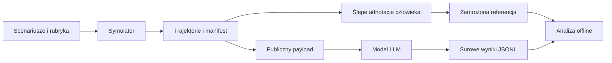

# TraceGuard Eval

Warsztat badawczy GSN do porównywania ocen LLM na obserwowalnych trajektoriach
agentów naprawiających incydenty. Działa z CLI bez serwera, bazy i GPU.
Wymagania pochodzą z [GSN_TraceGuard.pdf](GSN_TraceGuard.pdf).

Wykonano E1 i E2: protokół, rubrykę, 15 scenariuszy i 60 odtwarzalnych trajektorii.
Przygotowano narzędzia dalszych etapów. Referencje wymagają adnotacji człowieka,
a kalibracja i badanie wymagają wybranego modelu oraz budżetu API.
Nie ma jeszcze wyników naukowych, zamrożonych ludzkich etykiet ani raportu końcowego.

## Uruchomienie offline

Wymagania: Python 3.12, [uv](https://docs.astral.sh/uv/), Linux lub WSL.

```bash
uv sync --locked
uv run traceguard validate --dataset data/gsn-v1
uv run pytest -q
```

Odtworzenie zbioru w nowym katalogu:

```bash
uv run traceguard build --output artifacts/reproduced
uv run traceguard validate --dataset artifacts/reproduced
```

Generator odmawia nadpisania istniejących danych. Zbiór jest deterministyczny,
więc hashe i pliki obu generacji powinny być identyczne.

## Struktura i granice



- `src/traceguard_core`: schematy, rubryki, adnotacje, adapter, runner i analiza.
- `src/traceguard_sim`: stan w pamięci i rzeczywiste odtwarzanie operacji.
- `configs`: profile GSN/PP, wersjonowana rubryka i katalog scenariuszy GSN.
- `data/gsn-v1`: 60 trajektorii, manifest, konfiguracja i szkice referencji.
- `docs/protocol.md`: pytania, zasady adnotacji, podział i ograniczenia badania.
- `docs/progress.md`: aktualny stan kamieni milowych i dalsze działania.
- `notebooks/01_dataset.ipynb`: inspekcja materiału bez kopiowania logiki silnika.

GSN ma skalę 1–10 i podział 20/40. Profil PP ma skalę 1–5 i podział 80/40
dla docelowych 120 trajektorii. Generator w tej realizacji tworzy wyłącznie GSN.
Warstwa FastAPI/PostgreSQL projektu PP pozostaje poza zakresem tej realizacji.
Rdzeń nie importuje FastAPI ani SQLAlchemy.

## E3: niezależne adnotacje

Gotowe, nieocenione formularze znajdują się w `data/annotation_tasks/author.jsonl`
oraz `secondary.jsonl`. Zapisana próba drugiego annotatora obejmuje 20 trajektorii,
po dwie na scenariusz testowy; regułę i identyfikatory zawiera `secondary_sample.json`.
Do pracy skopiować formularze do `artifacts/`, zachowując oryginały. Zastąpić
identyfikatory `author` i `secondary` rzeczywistymi stałymi identyfikatorami osób.
Poniższe polecenia pozwalają również wyeksportować nowe formularze.

```bash
uv run traceguard annotations --dataset data/gsn-v1 --annotator autor --output artifacts/author.jsonl
uv run traceguard annotations --dataset data/gsn-v1 --annotator drugi-annotator --split test --output artifacts/secondary-all.jsonl
```

Każdy wiersz zawiera obserwacje i pusty formularz pięciu kryteriów. Annotator wpisuje
`PASS` albo `FAIL`, uzasadnienie i dowody `e1`, `e2`, ... lub `answer`, a po
rzeczywistym sprawdzeniu ustawia `reviewed: true`. Wszystkie kryteria dotyczą
obecnych scenariuszy; przypadki niejednoznaczne trzeba rozstrzygnąć lub poprawić
przed włączeniem do głównego testu. Nie kopiować planowanych klas generatora.

Drugi annotator ma pracować niezależnie, bez szkiców reguł i wyników LLM.
Przy użyciu pełnego eksportu 40 formularzy zachować 20 identyfikatorów z gotowego
`secondary_sample.json`, wybranych przed oceną. Przechować wybrane wiersze
w `artifacts/secondary.jsonl`. To etap wykonywany
przez człowieka; samo pole `origin: human` nie potwierdza, kto wypełnił formularz.

```bash
uv run traceguard freeze-references --dataset data/gsn-v1 --author artifacts/author.jsonl --secondary artifacts/secondary.jsonl --output artifacts/references.json
```

Spory wymagają osobnego pliku `--adjudications` z rozstrzygniętymi formularzami.
Bez drugiej osoby pominąć `--secondary`; raport oznaczy brak zgodności między
annotatorami. Sprzeczność etykiety z regułą deterministyczną wymaga poprawienia
scenariusza lub reguł przed zamrożeniem, a następnie ponownej walidacji materiału.

## E4: pilot i zamrożenie

Skopiować [judge.example.json](configs/judge.example.json) do nowego pliku,
wpisać wybrany model i endpoint dostawcy. Adapter oczekuje interfejsu zgodnego
z chat JSON: `choices[0].message.content` oraz opcjonalnego `usage`.
Obsługuje `global`, `criteria`, `score` i `pairwise`; porównanie wymaga tego
samego modelu, parametrów, rubryki i trybu dowodów. `full` oraz `final_only`
to odrębne warunki eksperymentu. Brak budżetu API nie blokuje części offline.

Klucz przekazać przez zmienną `TRACEGUARD_API_KEY`, ustawioną poza repozytorium.
Nazwa innej zmiennej może być podana przez `--api-key-env`. Program nie czyta `.env`.
Nie przekazywać klucza w argumentach ani pliku konfiguracji.

```bash
uv run traceguard run --dataset data/gsn-v1 --config artifacts/judge-global.json --registry artifacts/shared-splits.json --split pilot --output artifacts/pilot-global.jsonl
```

Każdy format uruchamia się osobno, w osobnym pliku wyników. Trzy powtórzenia
tworzą trzy wywołania, również przy temperaturze zero. Retry 429/5xx lub błędu
transportu pozostaje widoczny w zapisanych próbach. Brak tokenów jest brakiem,
a nie zerowym kosztem. Błędy formatu nie uruchamiają retry.

Dla `score` konfiguracja pilota ma `threshold: null`. Po zebraniu wyników:

```bash
uv run traceguard calibrate --dataset data/gsn-v1 --references artifacts/references.json --results artifacts/pilot-score.jsonl --registry artifacts/shared-splits.json --output artifacts/calibration.json
```

Pole `configuration` z kalibracji zapisać jako konfigurację formatu punktowego
do testu. Zamrożenie tego formatu wymaga `--calibration artifacts/calibration.json`.
Nie wybierać progu na danych testowych.

Dla pairwise najpierw przygotować pary pilotowe:

```bash
uv run traceguard pairs --dataset data/gsn-v1 --references artifacts/references.json --split pilot --output artifacts/pilot-pairs.json
uv run traceguard run --dataset data/gsn-v1 --config artifacts/judge-pairwise.json --registry artifacts/shared-splits.json --pairs artifacts/pilot-pairs.json --output artifacts/pilot-pairwise.jsonl
```

Po zakończeniu pilotażu zamrozić każdy format:

```bash
uv run traceguard freeze --dataset data/gsn-v1 --references artifacts/references.json --config artifacts/judge-global.json --registry artifacts/shared-splits.json --output artifacts/frozen-global.json
```

Zamrożenie zawiera hash kodu, danych, rubryki, promptu, referencji i konfiguracji.
Dla pairwise obejmuje 20 par testowych, w tym remisy. Używać jednego rejestru
`shared-splits.json` we wszystkich profilach i uruchomieniach. Usunięcie lub
zastąpienie rejestru usuwa historię blokad i łamie protokół badania.

## E5: test, wznowienie i analiza offline

```bash
uv run traceguard run --dataset data/gsn-v1 --config artifacts/judge-global.json --registry artifacts/shared-splits.json --split test --frozen artifacts/frozen-global.json --output artifacts/test-global.jsonl
uv run traceguard report --dataset data/gsn-v1 --references artifacts/references.json --results artifacts/test-global.jsonl --frozen artifacts/frozen-global.json --output artifacts/report-global
```

Ponowienie identycznego `run` wznawia zapis. Ukończone oceny, także ERROR po
wyczerpaniu retry, nie są wywoływane ponownie. Dalsza analiza takich braków wymaga
osobnego, jawnie opisanego uruchomienia. Runner odtwarza urwaną ostatnią linię;
odrzuca uszkodzenie wcześniejszej linii lub zmianę konfiguracji/kodu.

Raport JSON/CSV/HTML nie używa sieci. FAIL jest klasą dodatnią. Raport zachowuje
liczniki braków i błędów, nieokreślone miary jako `null`, stabilność kompletnych
trójek, zgodność par i zmiany po zamianie A/B. Kwota pieniężna pozostaje nieznana
do czasu zestawienia rzeczywistego cennika/rozliczenia dostawcy. Nie interpretować
macierzy na rozstrzygniętej części bez pokrycia i liczby oczekiwanych ocen.

Do notebooka i wykresów opcjonalnie:

```bash
uv sync --locked --group analysis
uv run --group analysis jupyter lab notebooks/01_dataset.ipynb
```

## Weryfikacja i ograniczenia

```bash
uv run pytest -q
uv build
git diff --check
```

Pełny zestaw tych kontroli można powtórzyć poleceniem `bash scripts/verify.sh`.
Do raportu kosztów zachować oba pliki: wyniki `.jsonl` i towarzyszący im dziennik
`.jsonl.attempts.jsonl`. Dziennik przechowuje także próby przerwane przed wynikiem.

Testy API używają `httpx.MockTransport`. Ich rezultaty sprawdzają implementację,
nie trafność wybranego LLM. Symulator modeluje uproszczone stany i jawne reguły;
nie jest emulatorem rzeczywistych systemów usługowych. Mały, kontrolowany zbiór
nie określa częstości błędów agentów w rzeczywistym użyciu. Raport i prezentacja
GSN powstaną po wykonaniu eksperymentu na niezależnych referencjach.
